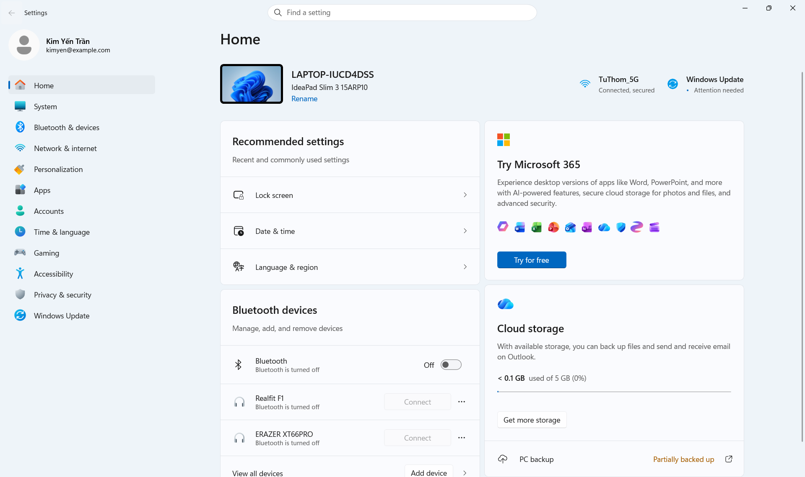
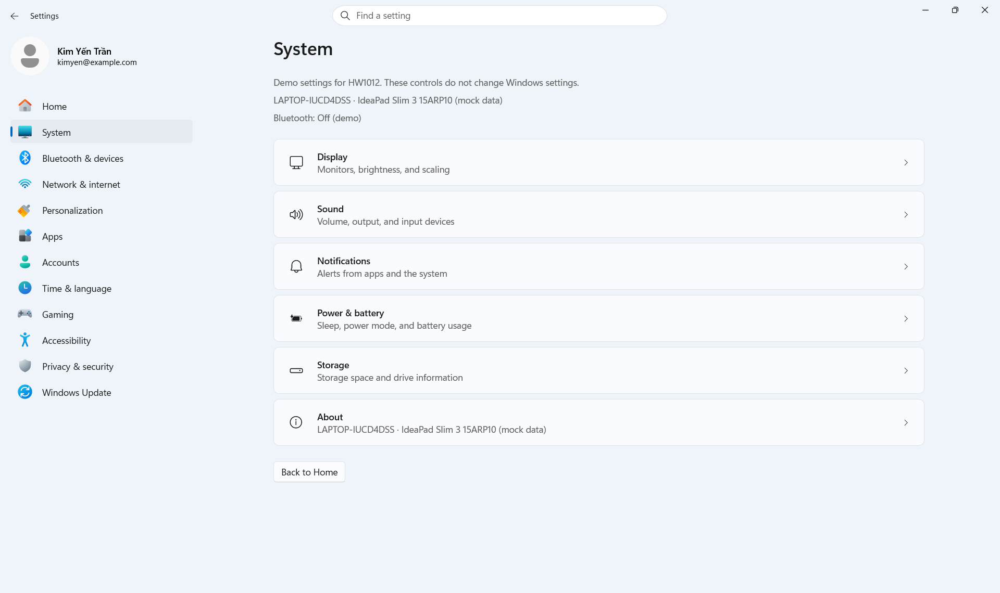
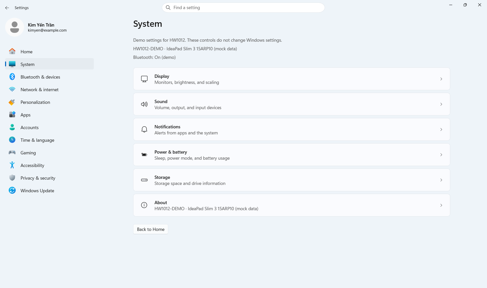
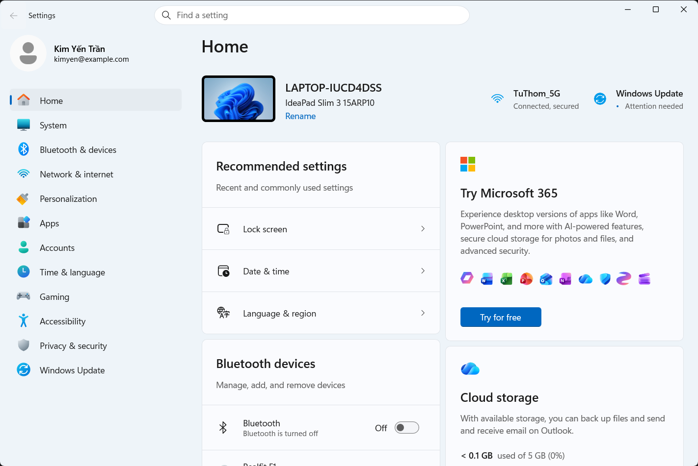
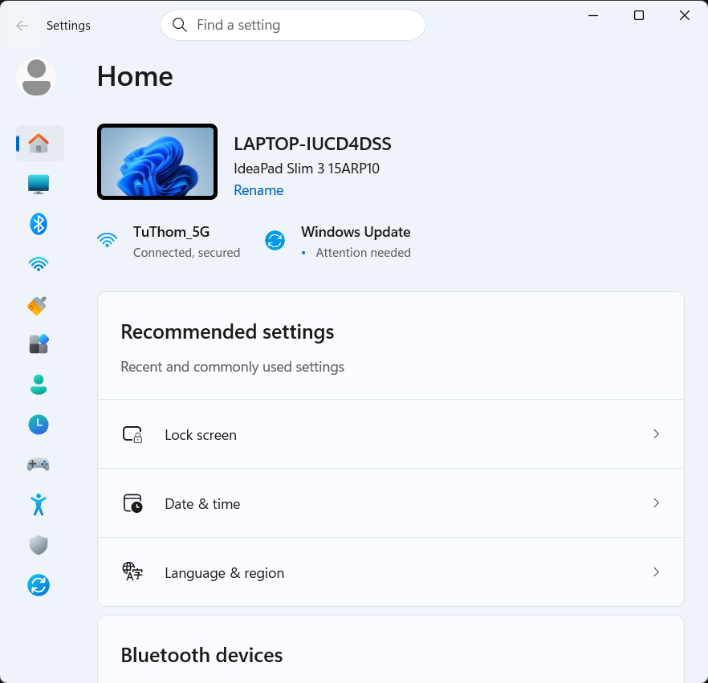
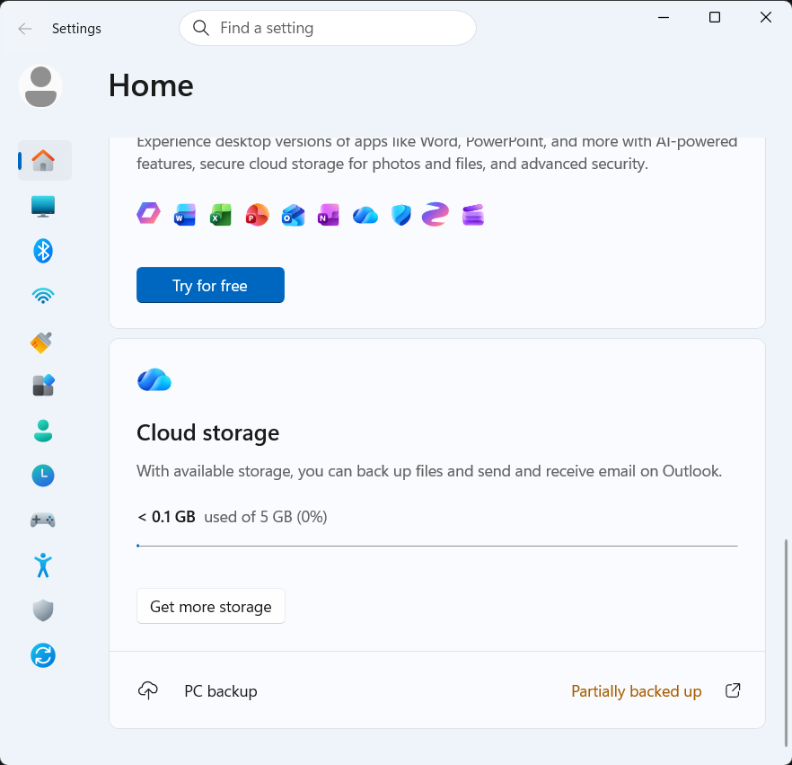
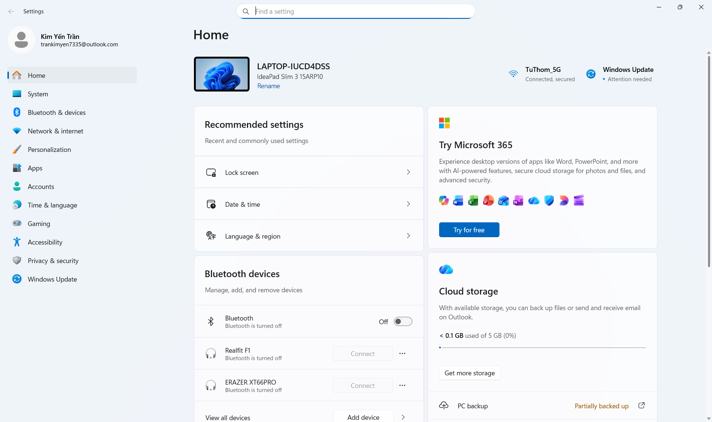

# HW1012 – Windows 11 Settings Home Clone

| Thông tin | Nội dung |
| --- | --- |
| Sinh viên | **Trần Kim Yến** |
| MSSV | **23120193** |
| Môn học | Lập trình Windows |
| Bài tập | HW1012 – Clone giao diện Windows 11 Settings Home |
| Công nghệ | C#, XAML, WinUI 3, Windows App SDK |

> **Lưu ý về ảnh tham khảo:** Bài làm đang bắt chước màn hình **Windows 11 Settings Home trên máy cá nhân của sinh viên Trần Kim Yến**. Ảnh giảng viên đưa trên LMS khá mờ, nên sinh viên dùng ảnh chụp cá nhân rõ hơn để đối chiếu chi tiết. File [References/settings-reference.png](References/settings-reference.png) là **ảnh của sinh viên**, không phải ảnh gốc của giảng viên. Bản chất bài tập vẫn là dựng giao diện Settings Home bằng WinUI 3 và thể hiện layout ở nhiều kích thước.

Ảnh LMS và ảnh cá nhân có dữ liệu/trạng thái khác nhau: tên máy, tài khoản, Recommended settings, Bluetooth, cloud storage và các card gợi ý. Bản triển khai bám ảnh cá nhân với **bốn card, Bluetooth Off và PC backup**; ảnh LMS có Bluetooth On và card Personalize your device. Vì vậy, bài không tuyên bố nội dung từng card trùng hoàn toàn ảnh LMS.

Ứng dụng tái hiện màn hình **Windows 11 Settings Home** từ [ảnh tham khảo cá nhân](References/settings-reference.png) bằng các control WinUI 3. Trọng tâm là bố cục, typography, màu sắc, card và khả năng co giãn khi resize. Bài làm đã có Home đầy đủ, một SystemPage đơn giản để minh họa navigation và truyền dữ liệu, cùng các tương tác dùng dữ liệu mẫu. Ứng dụng không thay đổi Windows Settings thật.

**Kết quả đã xác minh:** build Debug/x64 thành công; chạy ứng dụng trong context gói MSIX; kiểm tra navigation, Back, Bluetooth, Rename, tìm kiếm và dialog mock; chụp và xem giao diện ở ba kích thước cửa sổ. Bằng chứng chi tiết nằm trong [tài liệu kiểm thử](docs/IMPLEMENTATION_VALIDATION.md).

## Mục lục

- [Công nghệ và môi trường](#công-nghệ-và-môi-trường)
- [Mở, build và chạy](#mở-build-và-chạy)
- [Cấu trúc mã nguồn](#cấu-trúc-mã-nguồn)
- [Đối chiếu yêu cầu và phần đã triển khai](#đối-chiếu-yêu-cầu-và-phần-đã-triển-khai)
- [Kiến trúc và kỹ thuật đã sử dụng](#kiến-trúc-và-kỹ-thuật-đã-sử-dụng)
- [Ảnh chụp màn hình](#ảnh-chụp-màn-hình)
- [Tương tác và phạm vi mock](#tương-tác-và-phạm-vi-mock)
- [Kiểm thử và cách kiểm tra lại](#kiểm-thử-và-cách-kiểm-tra-lại)
- [Khác biệt còn lại và giới hạn](#khác-biệt-còn-lại-và-giới-hạn)
- [Lịch sử triển khai và chuẩn bị nộp bài](#lịch-sử-triển-khai-và-chuẩn-bị-nộp-bài)

## Công nghệ và môi trường

- C#, XAML, WinUI 3, Windows App SDK `2.5.1`.
- Target framework: `net8.0-windows10.0.19041.0`.
- Windows SDK BuildTools `10.0.28000.2705`.
- Windows và Visual Studio 2026, có công cụ phát triển WinUI/C# và Windows SDK phù hợp. Máy hiện tại đã có Visual Studio Community 2026 và .NET SDK `10.0.401`.

Không thêm NuGet package, không đổi SDK/target framework; dùng XAML và code-behind với các control WinUI có sẵn.

## Mở, build và chạy

1. Trong Visual Studio 2026, chọn **Open a project or solution** và mở `SettingsClone.slnx`.
2. Chờ NuGet restore hoàn tất. Đặt `SettingsClone` làm startup project nếu cần.
3. Chọn cấu hình **Debug**, nền tảng **x64**, và launch profile **SettingsClone (Package)**.
4. Chọn **Build > Build Solution** (`Ctrl+Shift+B`). Nhấn `F5` để chạy và debug, hoặc `Ctrl+F5` để chạy không debug.

Có thể build bằng MSBuild của Visual Studio trong PowerShell:

```powershell
& 'C:\Program Files\Microsoft Visual Studio\18\Community\MSBuild\Current\Bin\MSBuild.exe' .\SettingsClone.slnx /restore /t:Build /p:Configuration=Debug /p:Platform=x64 /verbosity:minimal /nologo
```

Đường dẫn MSBuild cần điều chỉnh nếu Visual Studio được cài ở vị trí khác. Nếu Visual Studio báo cần Developer Mode khi triển khai/debug gói MSIX, bật Developer Mode trong Windows rồi chạy lại.

Để đối chiếu ảnh tham khảo cá nhân, maximize cửa sổ và giữ display scaling phù hợp. Sử dụng profile **SettingsClone (Package)**; mở trực tiếp file `.exe` trong thư mục build có thể thiếu context gói MSIX và báo lỗi khởi tạo Windows App Runtime. Build bằng MSBuild không tự deploy ứng dụng như Visual Studio.

## Cấu trúc mã nguồn

```text
SettingsClone/
├── SettingsClone.slnx                 # Solution
├── SettingsClone.csproj               # Project WinUI 3
├── App.xaml / App.xaml.cs             # Tài nguyên và khởi động ứng dụng
├── MainWindow.xaml / MainWindow.xaml.cs
├── Package.appxmanifest               # Cấu hình gói MSIX
├── app.manifest                       # Manifest ứng dụng Windows
├── Pages/
│   ├── HomePage.xaml / HomePage.xaml.cs
│   └── SystemPage.xaml / SystemPage.xaml.cs
├── Models/                            # DeviceInfo, NavigationItem, SettingItem
├── Helpers/
│   └── DialogHelper.cs                 # Dialog dùng chung, chặn mở chồng
├── Assets/                            # Wallpaper, icon màu và minh họa cục bộ
│   └── ASSETS.md                      # Nguồn và giới hạn của minh họa
├── Properties/
│   ├── launchSettings.json            # Profile chạy
│   └── PublishProfiles/               # Profile win-x86, win-x64, win-arm64
├── References/
│   └── settings-reference.png         # Ảnh giao diện tham khảo
├── docs/
│   ├── HW1012_WinUI3_Lecture_Notes_for_Codex.md
│   ├── IMPLEMENTATION_VALIDATION.md    # Kết quả build/chạy và checklist review
│   └── screenshots/                   # Ảnh chụp ứng dụng thật ở các kích thước
├── .gitignore
├── AGENTS.md                          # Quy tắc cho coding agent, bằng tiếng Anh
└── README.md
```

`.vs/`, `bin/`, `obj/` và `SettingsClone.csproj.user` là dữ liệu cục bộ, không đưa vào Git.

## Đối chiếu yêu cầu và phần đã triển khai

Bảng dưới đây giúp đối chiếu từng phần của bài làm với mã nguồn và ảnh chụp. Đây là bảng mô tả kết quả thực tế, không phải rubric chấm điểm chính thức. Ảnh tham khảo cá nhân là nguồn đối chiếu chi tiết; [tài liệu bài giảng](docs/HW1012_WinUI3_Lecture_Notes_for_Codex.md) được dùng để chọn kỹ thuật phù hợp với môn học.

| Hạng mục | Phần đã triển khai | Mã nguồn / minh chứng |
| --- | --- | --- |
| Khung ứng dụng | Settings, Back và ô Find a setting; giữ nút Minimize/Maximize/Close thật của Windows | [MainWindow.xaml](MainWindow.xaml), [MainWindow.xaml.cs](MainWindow.xaml.cs) |
| Sidebar | Avatar, tên/email mẫu; đủ 12 mục; icon, highlight và indicator cho trang được chọn | [MainWindow.xaml](MainWindow.xaml), [Home lớn](docs/screenshots/home-large.png) |
| Device header | Minh họa thiết bị, LAPTOP-IUCD4DSS, IdeaPad Slim 3 15ARP10, Rename; Wi-Fi TuThom_5G; Windows Update Attention needed | [HomePage.xaml](Pages/HomePage.xaml) |
| Recommended settings | Tiêu đề, mô tả; Lock screen, Date & time, Language & region; icon, divider và chevron | [HomePage.xaml](Pages/HomePage.xaml) |
| Bluetooth devices | Bluetooth mặc định Off; Realfit F1, ERAZER XT66PRO; hai Connect disabled; menu ba chấm, View all devices và Add device | [HomePage.xaml](Pages/HomePage.xaml), [HomePage.xaml.cs](Pages/HomePage.xaml.cs) |
| Try Microsoft 365 | Logo, tiêu đề, mô tả, hàng minh họa ứng dụng và nút Try for free | [HomePage.xaml](Pages/HomePage.xaml), [Assets](Assets/ASSETS.md) |
| Cloud storage | Logo cloud, dung lượng dưới 0.1 GB trên 5 GB, ProgressBar, Get more storage, PC backup và Partially backed up | [HomePage.xaml](Pages/HomePage.xaml), [Home nhỏ khi cuộn](docs/screenshots/home-small-bottom.png) |
| Bố cục card | Hai StackPanel độc lập trong Grid hai cột; không ép card trái/phải có cùng chiều cao | [HomePage.xaml](Pages/HomePage.xaml), [Home vừa](docs/screenshots/home-medium.png) |
| Responsive | VisualStateManager/AdaptiveTrigger đổi cột, sidebar và vị trí nút; Home tính ngưỡng theo vùng nội dung thật | [HomePage.xaml](Pages/HomePage.xaml), [HomePage.xaml.cs](Pages/HomePage.xaml.cs), [MainWindow.xaml](MainWindow.xaml) |
| Navigation và truyền dữ liệu | Home mặc định; Navigate(type, DeviceInfo), OnNavigatedTo; Back kiểm tra CanGoBack; tránh lịch sử trùng; báo lỗi navigation nhẹ nhàng | [MainWindow.xaml.cs](MainWindow.xaml.cs), [SystemPage.xaml.cs](Pages/SystemPage.xaml.cs), [DeviceInfo](Models/DeviceInfo.cs) |
| Trang phụ System | Nhận tên máy/model/Bluetooth từ Home; sáu hàng setting qua DataTemplate; Back to Home | [SystemPage.xaml](Pages/SystemPage.xaml), [ảnh System](docs/screenshots/system.png) |
| Tương tác bổ sung | Bluetooth demo, Rename chặn tên trắng, tìm Home/System bằng Enter, thông báo demo cho các thao tác còn lại | [HomePage.xaml.cs](Pages/HomePage.xaml.cs), [MainWindow.xaml.cs](MainWindow.xaml.cs) |
| Build và kiểm thử | Debug/x64 đạt exit code 0; UI Automation, assets đóng gói, sự kiện XAML và ba kích thước UI | [IMPLEMENTATION_VALIDATION.md](docs/IMPLEMENTATION_VALIDATION.md) |

Phần clone Home và responsive là trọng tâm. SystemPage, Rename, tìm kiếm và Bluetooth demo bổ sung khả năng trình diễn navigation và xử lý sự kiện; các mục sidebar khác chưa có Page riêng.

## Kiến trúc và kỹ thuật đã sử dụng

Ứng dụng dùng **XAML và C# code-behind**, chia thành shell và hai Page. Cấu trúc giữ ở mức các kỹ thuật đã học; không sử dụng MVVM, Dependency Injection, Repository Pattern, database hoặc backend.

`MainWindow` chứa thanh tiêu đề/tìm kiếm, sidebar 12 mục và Frame. Một Page làm phần chứa shell để AdaptiveTrigger có control chủ quản; Frame vẫn điều hướng Home/System. Back chỉ hoạt động khi `CanGoBack`; selected state cập nhật theo trang. Các lớp Models chỉ chứa dữ liệu đơn giản. `DialogHelper` dùng chung một khóa chống mở chồng dialog cho cả cửa sổ, kể cả Rename.

```text
App
└── MainWindow
    ├── TitleBar + SearchBox
    ├── Profile + Sidebar
    └── Frame
        ├── HomePage (mặc định, có cache)
        └── SystemPage (trang phụ)
```

| Kỹ thuật / control | Cách áp dụng trong bài |
| --- | --- |
| Grid, Auto/Star, MaxWidth | Chia sidebar/nội dung, device header và hai cột card; vùng Home tối đa 1000 effective pixels |
| StackPanel, Border | Nhóm control, hai cột card độc lập; nền, viền, corner radius và padding của card |
| ScrollViewer | Cuộn nội dung Home/System; sidebar cuộn riêng khi thiếu chiều cao |
| TextBlock, Button, Image, FontIcon | Nội dung, thao tác, SVG minh họa và icon hệ thống |
| ToggleButton, VisualStateManager | Sidebar có trạng thái thường, hover, pressed và selected; chỉ trang hiện tại có indicator |
| ToggleSwitch, ProgressBar | Trạng thái Bluetooth demo và thanh dung lượng cloud |
| Frame, Page, OnNavigatedTo | Điều hướng có tham số DeviceInfo, lịch sử Back và cập nhật selected state |
| ItemsControl, DataTemplate, Binding | Một template cho 12 mục sidebar, một template cho sáu hàng System; Label/IconPath/Glyph lấy từ dữ liệu |
| ContentDialog, MenuFlyout | Rename, thông báo demo và menu ba chấm của thiết bị |
| VisualStateManager, AdaptiveTrigger | Setters trong XAML đổi cột, sidebar, hiện/ẩn tên mục và vị trí nhóm nút |
| SizeChanged | Tính ngưỡng trigger Home theo vùng nội dung/card; điều chỉnh liên tục chiều rộng ô tìm kiếm |
| ResourceDictionary / Style | Tập trung màu sắc, typography và styles tái sử dụng trong App.xaml |

Hai cột card là hai StackPanel độc lập trong Grid. Khi nội dung Home hẹp hơn 760 effective pixels, chúng chuyển thành một cột theo thứ tự Recommended → Bluetooth → Microsoft 365 → Cloud storage. Sidebar thu gọn thành icon khi cửa sổ hẹp hơn 760 effective pixels; tooltip vẫn cho biết tên mục. Nội dung Home có một ScrollViewer; sidebar cuộn riêng khi thiếu chiều cao.

Sidebar rộng 304 effective pixels ở cửa sổ rộng, 228 khi cửa sổ hẹp hơn 1000, và 72 ở chế độ icon. Các ngưỡng của sidebar dựa trên chiều rộng cửa sổ; số cột Home dựa trên chiều rộng nội dung còn lại. Hàng thiết bị và trạng thái backup đổi hàng khi card hẹp để tránh chồng chữ/nút. Vùng cuộn được giới hạn theo viewport để căn lề cùng tiêu đề Home.

WP06 được áp dụng qua `VisualStateManager` và `AdaptiveTrigger`: toàn bộ thay đổi thuộc tính layout nằm trong XAML. Vì AdaptiveTrigger đo cửa sổ, `UpdateAdaptiveThresholds()` chỉ chuyển ngưỡng nội dung sang ngưỡng cửa sổ bằng `windowWidth - contentWidth + breakpoint`. Cách này giữ mốc 760 của Home chính xác sau khi trừ sidebar/lề; không còn dùng `Grid.SetColumn/SetRow` trong SizeChanged. Xem [Microsoft Learn – responsive layouts](https://learn.microsoft.com/en-gb/windows/apps/develop/ui/layouts-with-xaml).

WP07 được áp dụng bằng `Navigate(typeof(SystemPage), home.GetDeviceInfo())`. System đọc `e.Parameter` trong `OnNavigatedTo` để hiển thị tên máy sau Rename, model và Bluetooth hiện tại; About dùng cùng dữ liệu. `DeviceInfo` là bản chụp trạng thái chỉ đọc, System không chỉnh sửa Home. Có giá trị mẫu dự phòng nếu trang được mở không có tham số.

`NavigationCacheMode="Required"` giữ HomePage khi chuyển trang: tên thiết bị và Bluetooth demo còn khi quay lại trong cùng phiên. Kiểm tra trang hiện tại trước khi Navigate tránh tạo lịch sử trùng; sự kiện Navigated cập nhật sidebar và Back. Không có lưu trữ lâu dài sau khi đóng ứng dụng.

Màu và style dùng chung nằm trong `App.xaml`. Thanh tiêu đề sử dụng control TitleBar có sẵn, giữ nút Minimize/Maximize/Close thật của Windows. Tham khảo API: [Microsoft Learn – TitleBar](https://learn.microsoft.com/en-us/windows/apps/develop/ui/controls/title-bar).

Để review mã nguồn, bắt đầu từ [MainWindow.xaml](MainWindow.xaml) và [.cs](MainWindow.xaml.cs), sau đó xem [HomePage.xaml](Pages/HomePage.xaml) và [.cs](Pages/HomePage.xaml.cs); styles nằm trong [App.xaml](App.xaml). [SystemPage](Pages/SystemPage.xaml) minh họa tách Page và lịch sử Frame; [AGENTS.md](AGENTS.md) ghi quy tắc phát triển repository.

Các điểm cần hiểu khi trình bày bài: `NavigationCacheMode` giữ cùng instance Home trong phiên; `Navigate(type, parameter)` đưa bản chụp DeviceInfo vào `OnNavigatedTo`; `CanGoBack` kiểm tra lịch sử trước khi Back. Binding `ViewportWidth` giới hạn vùng nội dung theo phần nhìn thấy của ScrollViewer, giúp căn lề và tránh tràn ngang. Template ToggleButton dùng CommonStates/Checked để thể hiện hover và selected; AdaptiveTrigger đổi bố cục theo kích thước. Cột icon rộng 24, bằng kích thước Image; khi thu sidebar, cột chữ và khoảng cách được đưa về 0 để icon không bị cắt.

## Ảnh chụp màn hình

Các ảnh dưới đây được chụp từ **ứng dụng chạy thực tế** trên Windows với display scaling **125% (120 DPI)**. Kích thước là pixel vật lý của vùng client, gồm title bar tùy biến. Home và System là hai Page đã triển khai; các ảnh Home khác nhau minh họa resize và vị trí cuộn của cùng một Page.

### Home – cửa sổ lớn, 1920 × 1140

Sidebar đầy đủ, device header và hai cột card độc lập. Home được chọn, Bluetooth Off và hai Connect disabled. Cuộn dọc để xem phần cuối nội dung.



### System – trang phụ minh họa navigation, 1920 × 1140

System được highlight trong sidebar; có sáu hàng setting, thông báo dữ liệu demo và nút Back to Home. Đây là trang phụ đơn giản, chưa clone đầy đủ Windows Settings System. Tên máy, model và Bluetooth phía trên các hàng được nhận từ Home qua tham số điều hướng.



Minh chứng truyền dữ liệu: đổi tên ở Home thành HW1012-DEMO và bật Bluetooth, sau đó mở System. Tên mới cũng xuất hiện trong hàng About.



### Home – cửa sổ vừa, 1422 × 951

Hai cột co giãn theo không gian còn lại sau sidebar. Văn bản xuống dòng và nhóm nút thiết bị chuyển hàng khi card hẹp.



### Home – cửa sổ nhỏ, 882 × 851

Sidebar chỉ còn icon; Wi-Fi/Update xuống dưới thông tin thiết bị. Các card xếp một cột theo thứ tự Recommended → Bluetooth → Microsoft 365 → Cloud storage.



### Home nhỏ – cuộn tới phần dưới

Cloud storage, Get more storage và PC backup đều truy cập được khi cuộn. Trạng thái Partially backed up vẫn hiển thị ở cửa sổ nhỏ.



Ảnh dùng để đối chiếu với kết quả trên:



## Tương tác và phạm vi mock

- Bluetooth mặc định Off và cả hai nút Connect disabled. Toggle chỉ thay đổi trạng thái demo, không điều khiển Bluetooth thật.
- Rename cho nhập tối đa 32 ký tự và thay đổi tên hiển thị của thiết bị demo; không cho lưu tên chỉ có khoảng trắng. Tên và trạng thái Bluetooth được giữ khi quay lại Home trong cùng phiên chạy.
- Nhập `Home` hoặc `System` vào ô tìm kiếm rồi nhấn Enter để mở trang tương ứng. Tìm kiếm khác hiển thị thông báo demo.
- Connect, các hàng Recommended settings, Add/View devices, menu thiết bị, Microsoft 365, storage/backup và các mục sidebar khác hiển thị thông báo mock. Không mở dịch vụ, thay đổi Windows hoặc giả vờ đăng ký/kết nối thành công.
- Các dữ liệu thiết bị, Wi-Fi, tài khoản, dung lượng và Windows Update đều là dữ liệu mẫu; email dùng địa chỉ `example.com`.
- Các hàng System và nút Wi-Fi/Update cũng hiển thị thông báo demo. Chỉ Home/System có navigation; chưa có Page chi tiết cho các mục còn lại.

## Kiểm thử và cách kiểm tra lại

Lượt kiểm thử giao diện được ghi nhận ngày **14/10/2026**, sau khi bổ sung truyền dữ liệu, AdaptiveTrigger, DataTemplate, dialog dùng chung và bộ icon màu. Ảnh chụp bên trên được cập nhật từ bản chạy này.

| Nhóm kiểm tra | Kết quả đã ghi nhận |
| --- | --- |
| Build Debug/x64 | MSBuild thành công, exit code 0; không còn lỗi compile do phần triển khai |
| Khởi chạy | Ứng dụng chạy dưới context MSIX; đã quan sát cửa sổ thật |
| XAML / assets | Event handlers khớp code-behind; wallpaper và SVG có trong gói; icon mới hiển thị trong app |
| Navigation / selected state | Home mặc định; Home/System/Back hoạt động; chọn lại Home không tạo lịch sử trùng; chỉ trang hiện tại được highlight |
| Bluetooth | Hai Connect disabled khi Off, enabled khi On, disabled lại khi tắt; giữ trạng thái khi quay lại Home |
| Rename / tìm kiếm / dialog | Chặn tên trắng, đổi label với tên hợp lệ; Enter Home/System mở đúng trang; Connect, Microsoft 365 và mục Apps báo demo |
| Tham số navigation | System nhận HW1012-DEMO sau Rename, đúng model và Bluetooth On/Off; Back về Home giữ trạng thái |
| Responsive / trực quan | Đã xem ảnh ở 1920 × 1140, 1422 × 951, 882 × 851 tại 125% scaling; không thấy chồng lấn rõ ràng trong ảnh đã kiểm tra; cuộn tới được PC backup |
| Review mã nguồn | Đã kiểm tra whitespace bằng git diff --check và rà soát dấu hiệu credential trong các file thay đổi |

Trong quá trình kiểm thử đã sửa lỗi await dialog thiếu `using System`, lệch căn lề nội dung ScrollViewer và highlight sidebar cũ còn sau khi đổi trang. Chi tiết cách xác minh và các giới hạn nằm trong [IMPLEMENTATION_VALIDATION.md](docs/IMPLEMENTATION_VALIDATION.md).

### Kịch bản kiểm tra nhanh cho người chấm

1. Build/chạy theo hướng dẫn, xác nhận Home xuất hiện mặc định và Back disabled khi chưa có lịch sử.
2. Maximize, đối chiếu bốn card, device header và sidebar với ảnh tham khảo cá nhân. Cuộn tới cuối để xem Add device và PC backup.
3. Resize lớn → vừa → nhỏ; quan sát hai cột chuyển thành một cột, sidebar thu gọn và nội dung vẫn cuộn được.
4. Chọn System: highlight chuyển sang System. Bấm Back trên title bar hoặc Back to Home để quay về Home.
5. Kiểm tra Bluetooth Off khóa hai Connect. Bật On, thử Connect để xem thông báo demo; sang System rồi Back để kiểm tra trạng thái còn giữ; tắt Off để khóa lại.
6. Bấm Rename, thử tên chỉ có khoảng trắng rồi một tên hợp lệ. Kiểm tra Save bị khóa với tên trắng và label đổi với tên hợp lệ. Sang System: tên máy/model/Bluetooth phải đúng trạng thái vừa đặt ở Home.
7. Nhập System, rồi Home vào ô tìm kiếm và nhấn Enter; thử Try for free hoặc Apps để thấy thông báo demo.

## Khác biệt còn lại và giới hạn

- **Assets:** dùng Windows Bloom cho hình thiết bị, icon sidebar màu và tám logo ứng dụng Microsoft từ nguồn chính thức. Một số icon sidebar, Copilot/Designer và tai nghe vẫn là hình dựng gần giống; không khẳng định giống từng pixel. Nguồn, phần điều chỉnh và giấy phép được ghi trong [Assets/ASSETS.md](Assets/ASSETS.md).
- **Ảnh tham khảo:** dùng màn hình cá nhân sinh viên do ảnh LMS mờ; dữ liệu/card khác ảnh LMS được công khai ở đầu README.
- **Phạm vi màn hình:** chỉ Home và System có Page. System là phần mở rộng minh họa navigation, chưa clone đầy đủ các trang Settings khác.
- **Chức năng:** sử dụng mock; không gọi Windows Settings API, backend hay dịch vụ cloud. Tìm kiếm chỉ hỗ trợ mở Home/System.
- **Môi trường chưa xác minh:** x86/ARM64, các máy/phiên bản Windows khác, nhiều mức DPI hoặc nhiều màn hình, high contrast và toàn bộ luồng screen reader.
- **Kiểm thử:** tập trung vào các luồng chính; chưa click kiểm tra riêng mọi mục menu flyout. Kết quả trực quan áp dụng cho các kích thước/scaling đã ghi nhận.

Ảnh trong README là bằng chứng review. Giao diện ứng dụng được dựng bằng control XAML; không dùng screenshot đề bài làm background hoặc cắt screenshot để giả lập các card.

## Lịch sử triển khai và chuẩn bị nộp bài

Các thay đổi ứng dụng được chia thành commit theo công việc để dễ review:

| Commit | Nội dung |
| --- | --- |
| `1aa5d32` | Thêm bốn minh họa SVG và khai báo assets |
| `76d0592` | Triển khai Home, shell và navigation Home/System |
| `112600e` | Tinh chỉnh căn lề Home và trình bày responsive |
| `c061093` | Sửa selected state sidebar và giới hạn layout System theo viewport |
| `38c4230` | Ghi kết quả kiểm thử, hướng dẫn chạy và thêm screenshot |
| `e677ede` | Bổ sung tài liệu bài giảng WinUI 3 vào repository |
| `8dab582` | Thêm thông tin sinh viên, hướng dẫn review và ảnh chụp |
| `ff308e9` | Thêm wallpaper và icon màu, ghi nguồn/giấy phép tài nguyên |
| `cc5d34e` | AdaptiveTrigger, DataTemplate, truyền DeviceInfo và dialog dùng chung |
| `6d4b1f2` | Sửa cột icon và khoảng cách ở sidebar thu gọn, tránh cắt hình |

Trước khi nộp: review UI và các commit, build/chạy lại bằng Visual Studio, kiểm tra resize và mock actions. Clean Solution trước khi đóng gói bài; bỏ `.vs/`, `bin/`, `obj/` và file IDE cá nhân, giữ mã nguồn, solution/project, tài nguyên và tài liệu cần thiết để build lại.
